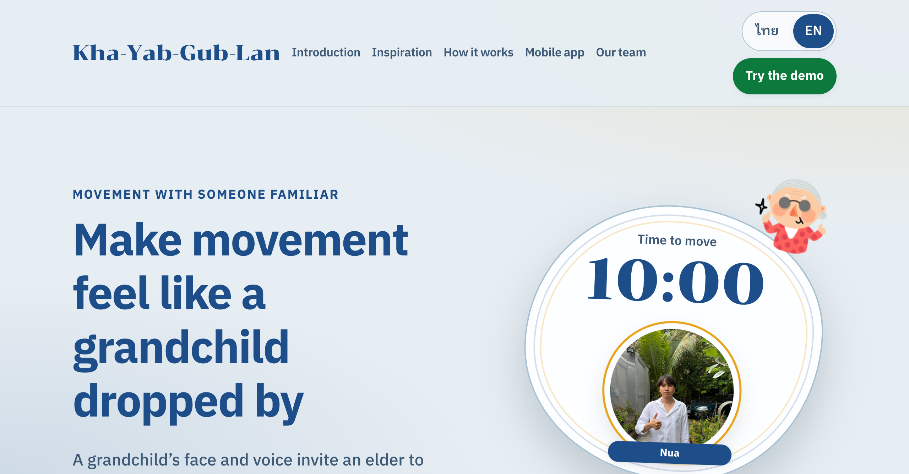
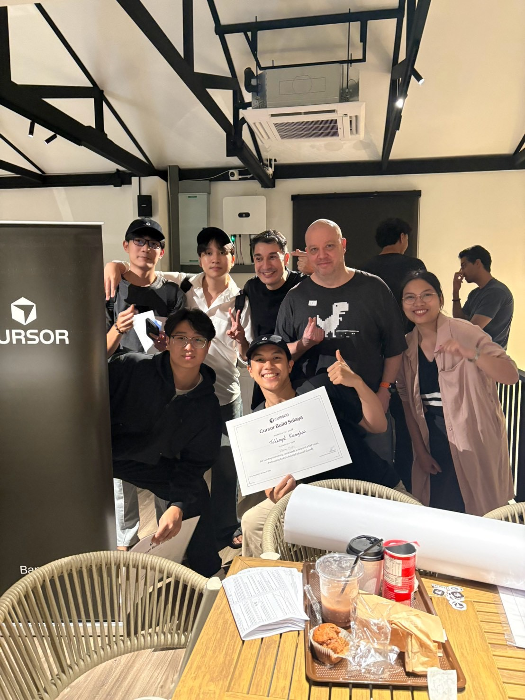
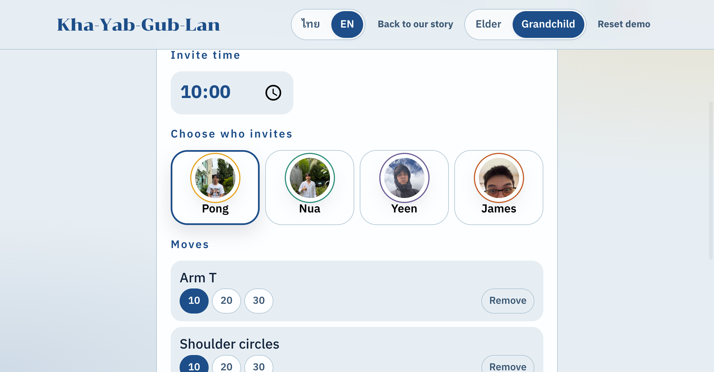
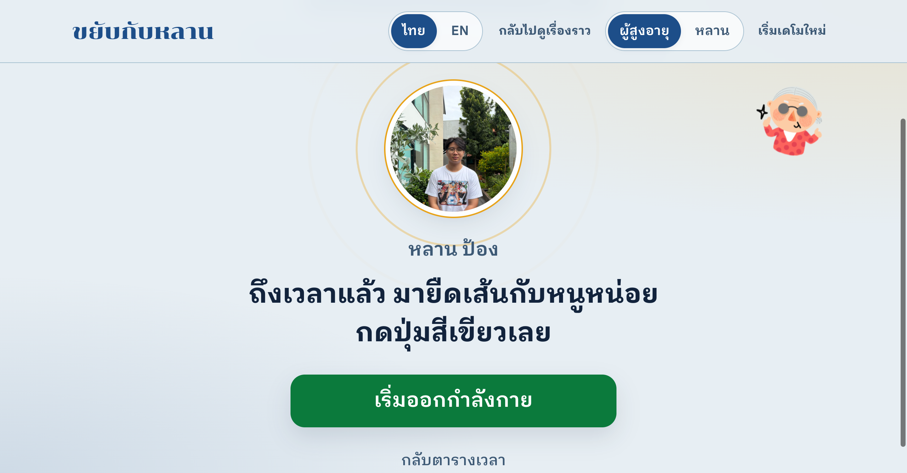
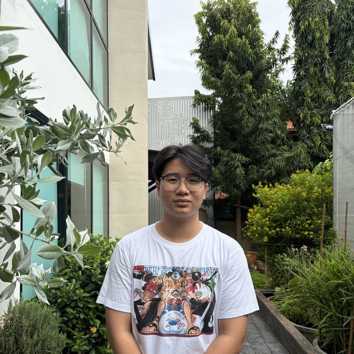
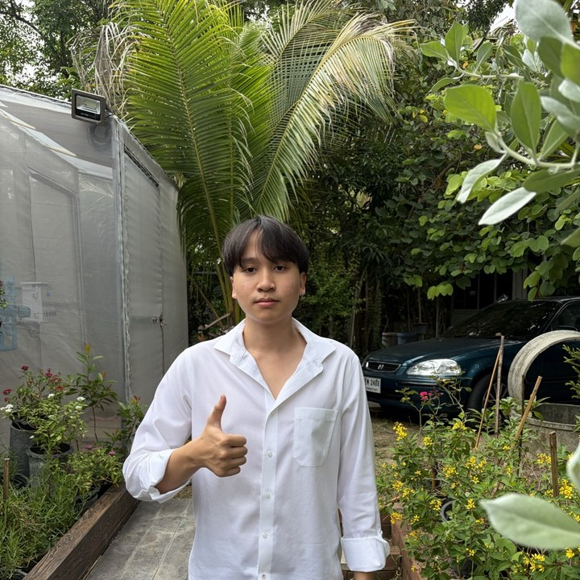
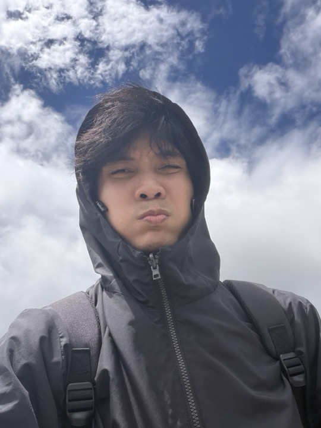

# Kha-Yab-Gub-Lan (ขยับกับหลาน)

> **Make moving feel like a visit from your grandchild**
> A web prototype that invites elders into seated exercise, using a grandchild's face and voice as the one who asks, with the camera checking their moves in real time.



---

## 💡 Where the idea came from

This project started with one question at **Cursor Build Salaya**:

> **"What would we build for someone we love?"**

Team **June Please** wanted to explore how technology could help care for family on the days when work, study, or distance keeps us from being there.

Many elders don't want to follow a health app or a trainer they don't know. But when **their grandchild is the one asking**, exercise stops feeling like a chore. It feels more like the grandchild dropped by to play.



---

## ✨ Key features

| Feature | Details |
| --- | --- |
| 🔔 **A call from the grandchild** | When it's time, the app plays a voice clip the grandchild recorded instead of a beep. The screen shows only the grandchild's face and one green button. |
| 🪑 **Seated exercises** | Every move can be done in a chair: Arm T, shoulder circles, alternate punch, arms up, and hands on head. |
| 📷 **Camera move checking** | MediaPipe Pose checks the elder's moves through the front camera in real time and shows large, easy-to-read feedback. |
| 🎉 **Praise at the end** | When the session ends, the grandchild gives praise by voice and on-screen text, then the app returns to the schedule. |
| 🌏 **Two languages** | Switch between Thai and English from the top bar. |
| 🔒 **Privacy** | Camera frames are processed on the device. No images or video leave it. |

---

## 🧭 How it works (3 steps)

### 1. The grandchild prepares
The grandchild picks the time, chooses who will do the asking, and builds a set of moves that suits the day.



### 2. The elder starts moving
Today's session waits on the elder's screen. At the set time, the elder sees the grandchild's face, hears their voice, and presses one button: **"Start exercise"**.



### 3. Feedback
The camera watches the elder's moves. A correct move earns praise in the grandchild's voice, and a move that isn't quite there gets a gentle nudge. After the last move, a praise screen appears

---

## 🛠️ Tech stack

- **HTML / CSS / JavaScript (ES modules)**: no framework and no build step
- **[MediaPipe Tasks Vision](https://developers.google.com/mediapipe)** for pose detection (Pose Landmarker)
- **Vitest** for testing the pose logic and the translation helpers

The reason this round ships as a website rather than a mobile app is in [`docs/adr/0001-web-for-hackathon-demo.md`](docs/adr/0001-web-for-hackathon-demo.md).

---

## 📁 Project structure

```
JunePlease/
├── index.html            # Story site (origin, how it works, team)
├── demo.html             # Working demo (elder / grandchild roles)
├── css/
│   ├── tokens.css        # Colors, fonts, spacing
│   ├── story.css         # Story page styles
│   └── demo.css          # Demo page styles
├── js/
│   ├── content.js        # Thai/English copy, grandchild data, preset move set
│   ├── i18n.js           # Translation helpers
│   ├── domain.js         # Pose-check logic for each move
│   ├── story.js          # Story page script
│   └── demo-app.js       # Demo script + camera + MediaPipe
├── sound_demo/           # Grandchild voice clips (call, correct, wrong, finish)
├── prop_image_people/    # Team / grandchild photos
├── prop_image_content/   # Stickers and event photos
├── tests/                # Vitest tests
└── docs/                 # ADRs, specs, plans, screenshots
```

---

## 🚀 Running locally

Serve the site from a local server (browsers allow camera access on `localhost`):

```bash
# With Python
python3 -m http.server 8000

# Or with Node
npx serve .
```

Then open:

- Story site: <http://localhost:8000/index.html>
- Demo: <http://localhost:8000/demo.html>
- Demo that starts the sample session right away: <http://localhost:8000/demo.html?entry=preset>

### Running the tests

```bash
npm install
npm test
```

---

## 📱 What's next

| Today | Next |
| --- | --- |
| Try the browser demo | A tablet app for every day |

Future ideas include fall detection and emergency alerts to family members. The details are in [`docs/superpowers/specs/`](docs/superpowers/specs/).

---

## 👥 Team June Please

<table>
  <tr>
    <td align="center"><br><b>Pong</b></td>
    <td align="center"><br><b>Nua</b></td>
    <td align="center"><br><b>Yeen</b></td>
    <td align="center"><br><b>James</b></td>
  </tr>
</table>

Four people turning a question about those we love into a prototype people can try.

> _Move together, a little closer._ 💚
